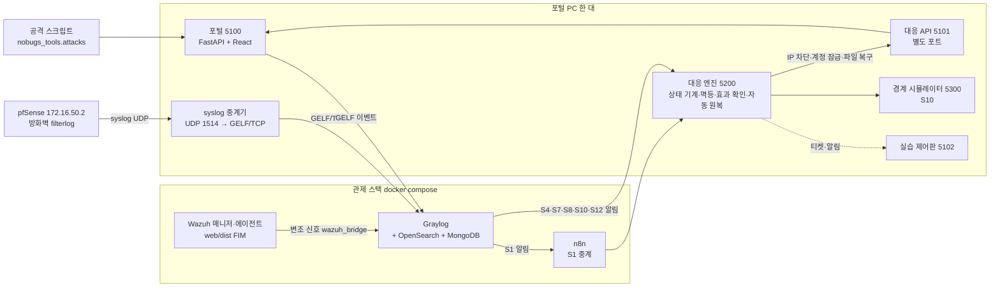

# nobugs-soar

공공기관 민원 포털을 공격 → **탐지(Graylog·Wazuh)** → **자동 대응(n8n·Python 대응 엔진)** → **차단·잠금·복구** → **티켓·효과 확인·자동 원복**까지 한 흐름으로 보여 주는 보안 관제·자동 대응(SOAR) 프로젝트입니다.

## 팀 원본과 본인 기여 범위

| 항목 | 내용 |
| --- | --- |
| 팀 원본 저장소 | [NoBugs-Aleph/aleph-soar-capstone](https://github.com/NoBugs-Aleph/aleph-soar-capstone) (관제·탐지·대응), [haedam-portal-backend](https://github.com/NoBugs-Aleph/haedam-portal-backend) · [haedam-portal-frontend](https://github.com/NoBugs-Aleph/haedam-portal-frontend) (민원 포털) |
| 팀 | NoBugs 1조 4인(2026.10~11) — 김명준, 김상혁(본인), 김대훈, 반소람 |
| 팀에서 본인 역할 | C 자리 — 티켓 저장소(상태 기계·멱등 처리)와 S7(홈페이지 변조) 복구 담당 |
| 이 저장소 | 팀이 PC 4대에 나눠 만든 것을 **혼자, PC 한 대에서, 처음부터 새로 설계·구현**한 것입니다. 포털·대응 엔진·탐지 규칙·복구 로직은 팀 코드를 보고 옮긴 것이 아니라 명세만 보고 새로 작성했습니다(작성 규칙 [docs/CLEANROOM.md](docs/CLEANROOM.md), 모듈별 출처 [docs/PROVENANCE.md](docs/PROVENANCE.md)). |
| 팀과 다른 점 | 팀은 대응을 n8n 워크플로로 조립했지만, 이 저장소는 대응 로직을 **직접 만든 Python 대응 엔진**(티켓 상태 기계·멱등·효과 확인·자동 원복)으로 구현했고, n8n은 Graylog 탐지를 엔진으로 중계하는 자리에 둡니다(S1). |

AI 코딩 도구(Claude Code)를 보조로 썼고, 설계 결정과 검증은 본인이 했습니다. 실측값은 모두 이 PC에서 직접 잰 것이며 팀 PC 4대에서 잰 값과 섞지 않았습니다. 비밀값은 `.env`에만 두고 저장소에는 [.env.example](.env.example)만 둡니다.

## 상태

**M6 완료, M7(측정·배포·문서) 진행 중 — S1·S4·S7·S8·S10·S12 여섯 케이스가 탐지부터 자동(또는 사람) 원복까지 자동으로 돕니다.** 파이썬 테스트 343건(깨끗한 클론에서 `pip install -e ".[dev]"` 뒤 `pytest`로 2026-11-11 재확인), 프론트 단위 23건, 브라우저 E2E 7건이 통과합니다.

실제 시험(2026-11-10, Graylog·포털·대응 엔진·경계 시뮬레이터를 실제로 띄워 확인):
- **S1**: 공격 후 10초 만에 차단·효과 확인, TTL 30초 뒤 자동 원복, 같은 IP의 티켓 2개도 교착 없이 함께 원복.
- **S4**(로그인 실패 뒤 성공, 계정 탈취 의심): 시험 계정(`zz_` 접두)의 로그인 실패 5회 뒤 성공 → 계정 잠금 + 세션 전부 회수, 자동 원복 안 됨. 관리자가 포털에서 잠금을 푼 뒤 `confirm-recovery`로 사람 복구 확인.
- **S8 → S10**: 스캔(404) + 로그인 실패로 S8이 IP를 차단, 같은 IP에 경계 차단 신호가 더해지면 같은 티켓이 S10으로 승격해 경계·앱을 함께 차단. 원복은 경계 → 앱 순서로 확인. S8은 TTL 20초 뒤 자동 원복.
- **S12**(요청 폭주): 가벼운 요청 120건을 몰아 보내도 서비스가 멀쩡하면(헬스체크 3회 모두 기준 이내) 티켓도 차단도 만들지 않음 — "무해한 폭주는 차단 안 함" 설계를 실측으로 확인.
- 시험 중 발견: Graylog의 S8·S10 정의가 같은 트래픽에 동시에 발동해 `ip_block`이 중복 기록되는 경쟁 조건 1건 → 엔진 판단·조치 구간을 직렬화해 수정(상세: [docs/PROVENANCE.md](docs/PROVENANCE.md)).

실제 시험(2026-11-10, 실제 Wazuh 매니저+에이전트를 띄워 확인 — **S7은 Active Response를 쓰지 않고 이 저장소의 설계(Wazuh FIM → `nobugs_tools.wazuh_bridge` → Graylog 집계 → 대응 엔진 웹훅)로 복구함**):
- **S7**(홈페이지 변조): 공격 스크립트로 포털이 실제로 서빙하는 파일(`web/dist`)을 직접 바꿔치고 방문자 접근을 재현 → 실제 Wazuh 에이전트가 실시간 FIM으로 변조를 감지 → bridge가 기준본과 다를 때만 `tamper-signal`을 Graylog로 전달 → 변조 신호 + 방문자 접근(2xx)이 같은 자산·파일에서 10분 안에 모이면 Graylog가 엔진 웹훅을 호출 → 엔진이 포털 대응 API로 파일을 기준본으로 복구하고 티켓이 `restored`로 바로 넘어감(복구 자체가 원복이라 자동 원복은 없음) → 사람이 `close`로 마무리. 기준본에 없는 새 파일이면 격리(`quarantine`)로 분기.
- 시험 중 발견·수정한 버그 2건(상세: [docs/PROVENANCE.md](docs/PROVENANCE.md)): ① Graylog 필드 값 계산이 `src_ip`를 필수로 요구해 `tamper-signal`(src_ip 없음) 쪽에서 이벤트 생성 자체가 조용히 실패 → S7만 `require_values=false`로 완화. ② 엔진 웹훅 알림 본문에 `asset_id`/`file_key`가 전혀 담겨 있지 않아 엔진이 매번 "보호 대상 아님"으로 조용히 무시(Graylog는 2xx로 보고 성공 처리) → 본문에 두 필드 추가.

M7 반복 측정 자동화(`python -m nobugs_tools.measure`)는 전체 스택(Wazuh 포함)으로 S1·S4·S7·S8·S10·S12 여섯 케이스를 각 N=5로 돌려 30회 중 29회 확인했습니다(S7 5회차 1건은 기준본 파일 4개를 돌려 쓰다 재알림 묵음 기간에 걸린 측정 설계의 한계였고, 실제 복구는 끝까지 됐습니다 — 결과는 [docs/MEASUREMENTS.md](docs/MEASUREMENTS.md)). 원클릭 설치(`scripts\setup.ps1`)도 `-WithWazuh`까지 포함해 실제로 여러 번 돌려 확인했습니다 — .env 생성, docker compose up, Graylog 준비 대기, S7 기준본 저장, Graylog 정의 설정, 상태 대조까지 한 번에 하고 끝에 포털·엔진을 띄우는 다음 명령을 안내합니다(시험 중 발견·수정한 결함은 [docs/PROVENANCE.md](docs/PROVENANCE.md)). 아키텍처 그림·스크린샷·회고는 아직입니다. 단계별 계획은 [docs/PLAN.md](docs/PLAN.md), 구현할 동작의 기준은 [docs/BEHAVIOR-SPEC.md](docs/BEHAVIOR-SPEC.md)입니다.

## 검증 표

"확인"은 실제 서버(포털·대응 API·엔진·Graylog, S7은 Wazuh까지)로 전체 사이클(공격 → 탐지 → 조치 → 원복 또는
사람 확인)을 완주한 것만 표시한다. 자세한 근거는 [docs/MEASUREMENTS.md](docs/MEASUREMENTS.md)(반복 측정)와
[docs/PROVENANCE.md](docs/PROVENANCE.md)(발견·수정한 결함)에 있다.

### 보안 케이스

| 케이스 | 공격 시나리오 | 탐지 | 대응 | 원복 | 실측(N=5, 2026-11-10) | 상태 |
| --- | --- | --- | --- | --- | --- | --- |
| S1 | 로그인 무차별 대입 | Graylog 집계(실패 9회↑/30분, username+src_ip) | IP 차단 | TTL 자동 | 5/5 | 확인 |
| S4 | 로그인 실패 뒤 성공(계정 탈취 의심) | Graylog 집계(실패+성공 합 6회↑) | 계정 잠금 + 세션 전부 회수 | 자동 원복 없음 — 사람이 `confirm-recovery`로 확인 | 5/5 | 확인 |
| S7 | 홈페이지 변조 | Wazuh FIM 실시간 감지 → `wazuh_bridge` → Graylog 집계(asset_id+file_key) | 기준본으로 복구(기준본에 없는 새 파일은 격리) | 복구 자체가 원복 — 사람이 `close`로 마무리 | 4/5(1건은 재알림 묵음 기간에 걸린 측정 설계의 한계, 실제 복구는 끝까지 됨) | 확인 |
| S8 | 웹 스캔 뒤 로그인 시도 | Graylog 집계(스캔+실패 합 5회↑, src_ip) | IP 차단 | TTL 자동 | 5/5 | 확인 |
| S10 | 스캔·로그인·경계 신호 연쇄(S8 승격) | Graylog 집계(세 종류 모두, src_ip) | IP 차단 + 경계 차단(시뮬레이터) | TTL 자동(경계 → 앱 순서) | 5/5 | 확인 |
| S12 | 요청 폭주 | Graylog 집계(94건↑/분, src_ip) | 조건부 — 헬스체크로 서비스가 실제로 느려졌을 때만 | 해당 없음(무해하면 조치 자체를 안 함) | 5/5(5회 모두 "조치 없음"이 맞는 결과) | 확인 |

### 인프라·도구

| 항목 | 상태 | 근거 |
| --- | --- | --- |
| Graylog 연동(GELF 입력·집계 정의·엔진 웹훅 알림) | 확인 | 위 6케이스 전부 |
| Wazuh 매니저+에이전트 실연동(S7 FIM) | 확인 | docs/PROVENANCE.md(M6) |
| n8n 자동 대응(S1: Graylog → n8n → 대응 엔진) | 확인 | 실제 S1 공격으로 n8n 경유 티켓 생성·차단·효과 확인(docs/PROVENANCE.md). S1의 Graylog 알림 대상은 n8n 하나뿐이라 이 경로로만 발동한다 |
| pfSense 방화벽 로그 → Graylog(실제 VM) | 확인 | pfSense CE 2.7.2 VM(VMware)에서 원격 syslog를 켜고, 호스트 중계기(`nobugs_tools.syslog_relay`)를 거쳐 실제 **방화벽 차단 로그(filterlog)와 시스템 로그가 Graylog에 들어오는 것**을 실측(source=172.16.50.2). pfSense WAN의 막힌 포트로 접속을 시도해 filterlog `block,in`이 Graylog에 쌓이는 것을 확인. 중계기가 필요한 이유·막혔던 점은 아래 "pfSense 방화벽 로그 수집" 참고. pfSense **차단 자동화**(엔진이 pfSense를 조작해 IP 차단)는 아직 범위 밖 |
| 경계 시뮬레이터(`nobugs_boundary`, S10) | 부분 | 상태만 관리하는 시뮬레이터다. 실제 패킷 차단·실제 프록시 연동은 범위 밖([docs/PLAN.md](docs/PLAN.md) M5) |
| N=5 반복 측정 자동화(`nobugs_tools.measure`) | 확인 | docs/MEASUREMENTS.md |
| 원클릭 설치(`scripts\setup.ps1`) | 확인 | docs/PROVENANCE.md |
| 실습 제어판(`nobugs_tools.panel`) | 확인 | 공격 버튼 → 엔진 티켓이 6단계(공격→탐지→조치→반영 확인→효과 확인→원복)를 밟는 것을 한 화면·5초 자동 갱신으로 확인. S8 실공격으로 신규 티켓이 ⑤까지 완료되는 것을 실측 |
| 프론트 E2E(Playwright) | 확인 | 7건 통과 |
| 다른 팀과의 공방전 | 미확인 | 일정·대상·규칙·채점 기준 미정(팀 캡스톤 쪽 결정 사항, 이 저장소 밖) |

## 알려진 한계

숨기지 않고 적어 둡니다. 해결하면 이 표에서 지웁니다.

| 항목 | 현재 상태 | 이유·대안 |
| --- | --- | --- |
| 엔진 조회 API 인증 | `GET /api/v1/tickets*`, `/api/v1/notifications`, 대시보드 `/`는 키 없이 읽힌다(쓰기·웹훅은 `X-Engine-Key` 필요) | 엔진은 `127.0.0.1`에만 열린다(`nobugs_engine/__main__.py`). 다른 PC에서 보게 하려면 조회에도 키를 요구하도록 바꿔야 한다 |
| Python 3.12 | CI 행렬로만 확인 | 개발 PC에는 3.14만 있다. 3.14에서는 새 클론으로 전체 테스트 통과를 확인했다 |
| 새 클론 전체 설치 | 파이썬 쪽만 확인 | 새 클론에서 `setup.ps1`로 docker 스택까지 처음부터 올리는 경로는 아직 시험하지 않았다(지금 PC에는 이미 떠 있는 스택이 있어 포트가 겹친다) |
| pfSense 연동 | 부분 | 위 인프라 표 참고 |
| S7 N=5 측정 | 4/5 | 기준본 파일 4개를 돌려 써 5회차가 재알림 묵음 기간(10분)에 걸린다. 측정 설계의 한계 |

의존성 버전은 [constraints.txt](constraints.txt)로 고정합니다(새 클론에서 설치·테스트 통과를 확인한 조합). CI와
`scripts\*.ps1`이 `-c constraints.txt`로 설치합니다. 버전을 올릴 때는 Dependabot PR이 CI를 통과하는지 봅니다.

## 구성



포털은 이벤트만 내보내고 판단하지 않습니다. 판단·조치·원복은 대응 엔진 한 곳이 하고, 포털의 대응 API는
일반 포털과 **다른 포트**로 분리돼 있어 외부에서 일반 포털로는 닿지 않습니다.

구성 요소·포트·6단계 흐름·로그 수집 경로는 [docs/ARCHITECTURE.md](docs/ARCHITECTURE.md)에 자세히 있습니다.

## 처음부터 한 번에(원클릭 설치)

```powershell
.\scripts\setup.ps1              # venv·deps·프론트 빌드·.env·docker compose up·Graylog 설정·상태 대조까지 전부
.\scripts\setup.ps1 -WithWazuh   # S7용 wazuh-manager+agent도 같이(무거움, 측정일에만)
.\scripts\setup.ps1 -Live        # Graylog 알림을 실제 조치 모드로(기본은 모의 실행)
```

끝나면 상태 대조 결과와 함께 포털·대응 API·엔진을 띄우는 명령을 안내합니다. 세 프로세스는 각자 터미널에서
보며 시연해야 해서 이 스크립트가 직접 띄우지는 않습니다. 이미 떠 있는 스택에 설정만 다시 올리려면
`-SkipDocker`, 프론트를 다시 빌드하지 않으려면 `-SkipFrontend`를 붙입니다.

## 단계별 수동 실행

아래는 원클릭 설치를 쓰지 않고 구성 요소를 하나씩 띄워 볼 때의 명령입니다. 먼저 포털 백엔드만 띄웁니다.

```powershell
py -m venv .venv; .\.venv\Scripts\python.exe -m pip install -e ".[dev]"
$env:NB_RESPONSE_API_KEY='<무작위 키>'; $env:NB_RESPONSE_ALLOWED_CIDRS='127.0.0.0/8'
.\.venv\Scripts\python.exe -m uvicorn nobugs_portal.app:public_factory --factory --port 5100 --app-dir src      # 일반 포털
.\.venv\Scripts\python.exe -m uvicorn nobugs_portal.control:control_factory --factory --port 5101 --app-dir src  # 대응 API(별도 프로세스)
.\scripts\test.ps1   # 린트 + 테스트
```

### 관제 스택(Graylog)과 S1 탐지

```powershell
python -m nobugs_tools.make_env                                         # .env 생성(무작위 비밀값, 콘솔 출력 없음)
docker compose -f infra/docker-compose.yml --env-file .env up -d        # Graylog+OpenSearch+MongoDB (웹 127.0.0.1:9100)
python -m nobugs_tools.graylog setup                                    # GELF 입력 + S1 탐지 정의 올리기(멱등)
$env:NB_GELF_ENABLED='true'; $env:NB_GELF_PORT='12301'                  # 포털 이벤트를 Graylog로 보내기
python -m nobugs_tools.attacks s1 --source 127.0.0.2 --user victim_a    # 공격 재현(루프백 전용)
python -m nobugs_tools.graylog events                                   # 발동한 이벤트 보기(최대 약 1분 뒤)
```

### 대응 엔진(S1)

```
python -m nobugs_tools.make_env                      # 엔진 키·포털 대응 키·경계 키가 .env에 덧붙음(기존 값은 유지)
python -m uvicorn nobugs_portal.control:control_factory --factory --port 5101 --app-dir src   # 포털 대응 API(별도 프로세스)
python -m uvicorn nobugs_boundary.app:boundary_factory --factory --port 5300 --app-dir src    # 경계 시뮬레이터(S10, 선택)
python -m nobugs_engine                              # 대응 엔진 http://127.0.0.1:5200 (티켓·알림 화면 포함)
python -m nobugs_tools.graylog setup --engine-url http://host.docker.internal:5200/webhook/graylog          # 모의 실행 모드
python -m nobugs_tools.graylog setup --engine-url http://host.docker.internal:5200/webhook/graylog --live   # 실제 조치 모드
```

엔진은 기본이 **모의 실행**입니다(`NB_ENGINE_DRY_RUN=false` 또는 알림 본문의 `dry_run:false`로만 실제 차단). 자동 원복 대기 시간은 `NB_ENGINE_RELEASE_TTL`(기본 90초).

### n8n 자동 대응(S1)

S1 탐지만 Graylog → **n8n** → 대응 엔진 순서로 흐릅니다(나머지 케이스는 Graylog → 엔진 직결). n8n은 받은
본문을 그대로 엔진 웹훅으로 넘기므로, 티켓·차단·효과 확인·원복은 검증된 엔진 로직이 그대로 처리하고 n8n에는
실행 기록이 남습니다. 관리 화면은 `http://127.0.0.1:5678` (로그인 값은 `.env`의 `NB_N8N_USER`/`NB_N8N_PASSWORD`).

```powershell
docker compose -f infra/docker-compose.yml --env-file .env up -d n8n
python -m nobugs_tools.n8n_setup                 # 자격 증명·워크플로 반입 후 활성화
python -m nobugs_tools.graylog setup --engine-url http://host.docker.internal:5200/webhook/graylog `
    --n8n-url http://n8n:5678/webhook/s1 --live  # S1만 n8n 경유로 연결
python -m nobugs_tools.attacks s1 --source 127.40.0.1 --user zz_demo --count 10
```

n8n에서 겪은 것(그대로 적어 둡니다): `import:workflow`는 JSON 최상위에 `id`가 없으면 SQLite NOT NULL로
실패하고, 가져온 워크플로는 기본 비활성이라 `publish:workflow` 뒤 컨테이너를 재시작해야 활성화됩니다. 표현식의
`$env` 접근은 기본 차단이라 키는 n8n 자격 증명으로 넘겨야 합니다. 그리고 `latest` 이미지는 메모리 512m에서
Node 힙 OOM으로 죽어 1536m로 올렸습니다.

### Wazuh FIM과 S7(홈페이지 변조)

공식 `wazuh/wazuh-agent` 이미지는 없어 매니저와 같은 버전의 `.deb`로 직접 빌드한다(인덱서·대시보드는 쓰지 않음 — 매니저가 로컬에 쓰는 `alerts.json`을 bridge가 직접 읽는다). Active Response는 쓰지 않고 탐지만 매니저로 보낸 뒤 Graylog 집계·엔진 웹훅으로 복구한다.

```powershell
docker compose -f infra/docker-compose.yml --env-file .env up -d wazuh-manager wazuh-agent   # 매니저+에이전트(web/dist를 FIM으로 감시)
.\.venv\Scripts\python.exe -m nobugs_portal.cli seed-baseline                                 # 지금 web/dist를 기준본으로 저장
python -m nobugs_tools.wazuh_bridge --alerts-log infra/wazuh/logs/alerts/alerts.json --agent-prefix /nobugs/web-root   # 변조 신호를 Graylog로 중계
python -m nobugs_tools.attacks s7 --file-key index.html                                       # 변조 재현(파일을 직접 바꾼 뒤 방문자 접근까지)
```

Git Bash에서 `--agent-prefix`처럼 `/`로 시작하는 인자는 Windows 경로로 자동 변환되니 `MSYS_NO_PATHCONV=1`을 붙인다.

### pfSense 방화벽 로그 수집

pfSense(VMware VMnet2, `172.16.50.2`)의 방화벽 로그를 Graylog로 모은다. pfSense 쪽은 **Status → System Logs →
Settings → Remote Logging**에서 원격 서버를 `<VMnet 호스트 IP>:1514`, Contents를 Everything(또는 Firewall)으로 켠다.
호스트 쪽은 중계기를 띄운다:

```powershell
python -m nobugs_tools.syslog_relay    # 172.16.50.100:1514에서 받아 GELF/TCP로 Graylog에 넣는다
```

중계기를 **거치는 이유**(이번에 실제로 막혀서 하나씩 뚫은 것들):

1. **Windows 방화벽**이 인바운드 UDP 1514를 막고 있었다 → 랩 망(`172.16.50.0/24`)만 허용하도록 규칙을 좁혔다.
2. **Docker Desktop(WSL2)은 UDP 게시 포트 전달이 불안정**하다. 외부 호스트發 UDP는 컨테이너로 거의 안 넘어가고,
   루프백으로 되쏴도 드롭된다(실측: 20건 중 0건). 반면 호스트 네이티브 UDP 소켓은 외부 패킷을 정상 수신하고,
   Docker의 **TCP 전달은 안정적**이다. 그래서 중계기가 네이티브 소켓으로 받아 **GELF/TCP**로 Graylog에 넣는다.
3. 중계기 소켓에 **`SO_REUSEADDR`를 쓰면 Windows에서 외부 UDP 수신이 막힌다** → 쓰지 않는다.

GELF의 `host`를 보낸 IP로 넣어 Graylog `source`가 `172.16.50.2`(pfSense)로 찍힌다(pfSense syslog는 호스트네임
필드가 없어 UDP 출발지로만 구분된다). 확인: pfSense WAN의 막힌 포트로 접속을 시도하면 Graylog에서
`filterlog ... block,in` 메시지가 `source:172.16.50.2`로 쌓인다.

### 반복 측정(M7)

포털·대응 API·엔진·Graylog가 뜬 상태에서(S7도 재려면 Wazuh까지) 케이스별 N회를 공격부터 효과 확인까지 재고
표로 남긴다. 결과는 [docs/MEASUREMENTS.md](docs/MEASUREMENTS.md)에 기록한다.

```powershell
python -m nobugs_tools.measure --case S1,S4,S8,S10,S12 --rounds 5 --out docs/MEASUREMENTS.md
python -m nobugs_tools.measure --all --rounds 5   # S7까지 포함(Wazuh 필요)
```

도구를 다시 돌릴 때는 `--salt`(기본은 실행 시각 기준)가 바뀌어 출발지 IP가 겹치지 않는다 — 같은 IP를 또 쓰면
포털의 로그인 횟수 제한(출발지당 5분에 20회)에 걸려 실제로는 통과할 시도도 막힌다.

### 실습 제어판(시연용)

공격 → 탐지 → 조치 → 반영 확인 → 효과 확인 → 원복을 한 화면에서 본다. 제어판은 스스로 상태를 만들지 않고
엔진 REST API를 읽어 티켓·액션을 6단계로 환산해 5초마다 자동 갱신한다. 위쪽 버튼으로 공격을 재현하면
몇 초 뒤 새 티켓이 올라오며 단계가 초록으로 차오르고, `restored`가 된 티켓에는 **사람 확인(닫기)** 버튼이 생긴다.

```powershell
python -m nobugs_tools.panel        # http://127.0.0.1:5102 (엔진 5200·포털 5100이 떠 있어야 한다)
```

버튼으로 쏘는 공격은 비밀값이 필요 없는 것만 둔다(S1·S8·S10, 그리고 Wazuh가 떠 있을 때 S7). S4는 시험 계정
비밀번호가 필요해 버튼에서 뺐다. 닫기 버튼은 엔진 키(.env의 `NB_ENGINE_KEY`)를 제어판 서버가 쥐고 호출한다.

### 프론트(React) 빌드·실행

```powershell
cd web; npm ci; npm run build          # 타입 검사 + 빌드 -> web/dist (포털이 / 로 서빙)
npm test                                # 단위 테스트(vitest)
npm run test:e2e                        # 실제 브라우저 E2E(Playwright, 임시 DB로 서버를 직접 띄움)
cd ..; $env:NB_DATABASE_URL='sqlite:///instance/portal.sqlite3'
.\.venv\Scripts\python.exe -m nobugs_portal.cli seed-demo                 # 시연 계정 3개(비밀번호는 한 번만 표시)
.\.venv\Scripts\python.exe -m uvicorn nobugs_portal.app:public_factory --factory --port 5100 --app-dir src
```

## 개발 방식

- 동작 명세와 테스트를 먼저 쓰고 구현합니다. 각 단계는 시연 가능한 결과로 끝납니다.
- AI 코딩 도구(Claude Code)를 보조로 사용합니다. 설계 결정과 검증은 본인이 합니다.
