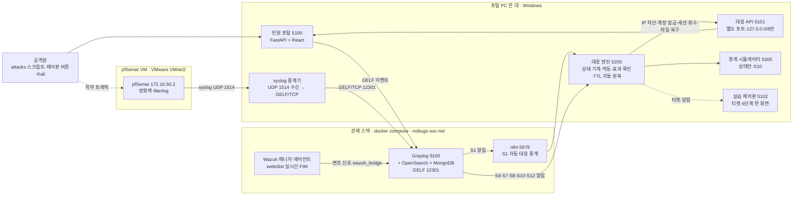
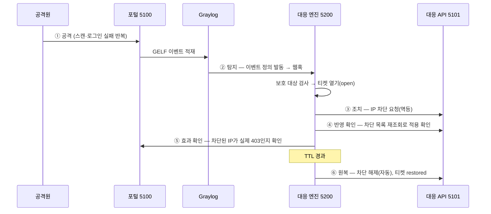
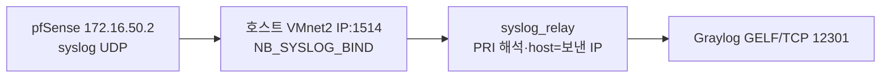

# 아키텍처

이 문서는 nobugs-soar 전체 구조를 한 장으로 본다. 포털이 이벤트를 내보내고, 관제(Graylog·Wazuh)가
탐지하고, 대응 엔진 한 곳이 판단·조치·효과 확인·자동 원복을 한다. 실제로 측정·확인한 것과 시뮬레이터·범위
밖인 것을 표에서 구분한다(측정 원본은 [MEASUREMENTS.md](MEASUREMENTS.md), 출처·검증 이력은
[PROVENANCE.md](PROVENANCE.md)).

## 1. 시스템 구성도

핵심 원칙: **포털은 이벤트만 내보내고 판단하지 않는다.** 판단·조치·원복은 대응 엔진 한 곳이 하고,
대응 API(5101)는 일반 포털(5100)과 다른 포트로 분리돼 외부에서 일반 포털로는 닿지 않는다.

## 2. 구성 요소와 포트

| 구성 요소 | 포트(127.0.0.1) | 역할 | 상태 |
| --- | --- | --- | --- |
| 민원 포털 | 5100 | 시민·담당자·관리자 화면, 이벤트 발생원 | 확인 |
| 대응 API | 5101 | 엔진이 호출하는 조치 경로(차단·잠금·복구), 출발지 `127.0.0.0/8`만 허용 | 확인 |
| 대응 엔진 | 5200 | 웹훅 수신 → 보호 대상 검사 → 티켓 → 조치(멱등) → 반영·효과 확인 → TTL 원복 | 확인 |
| 경계 시뮬레이터 | 5300 | S10의 경계 차단 **상태만** 관리(실제 패킷 차단 아님) | 시뮬레이터 |
| 실습 제어판 | 5102 | 공격 버튼 + 티켓 6단계를 한 화면에서 자동 갱신 | 확인 |
| syslog 중계기 | UDP 1514 수신 | pfSense syslog를 받아 Graylog에 GELF/TCP로 넣음 | 확인 |
| Graylog | 9100(웹·API), 12301(GELF udp/tcp) | 로그 수집·이벤트 정의·알림 | 확인 |
| Wazuh | 1514/1515(tcp) | web/dist 실시간 FIM, 변조 탐지(S7) | 확인 |
| n8n | 5678 | S1 탐지를 받아 같은 본문을 엔진 웹훅으로 중계(자동 대응 흐름 가시화) | 확인 |

> 포트·버전은 [infra/docker-compose.yml](../infra/docker-compose.yml)과 각 모듈의 기본값 기준이다.

## 3. 대응 한 사이클(6단계)

제어판이 티켓마다 보여주는 6단계를 시간순으로 본 것. 예시는 S8(스캔+로그인 실패 → IP 차단).

- 티켓 상태 기계: `open → responding → verified → restored → closed`. (케이스, 키)당 열린 티켓은 1개.
- S7(파일 변조→복구)은 효과 확인 뒤 바로 원복 단계로 간다(차단이 아니라 기준본 복구이므로).
- 닫기(closed)는 사람이 한다. 원복은 TTL로 자동, 별도 해제 API는 두지 않는다.

## 4. 로그가 Graylog로 들어오는 세 경로

| 경로 | 보내는 쪽 | 받는 입력 | 비고 |
| --- | --- | --- | --- |
| 애플리케이션 이벤트 | 포털(5100) | GELF 12301 | 로그인 실패·404·파일 접근 등, 구조화 JSON |
| 파일 무결성 | Wazuh 에이전트 → 매니저 → `wazuh_bridge` | GELF 12301 | web/dist 실시간 FIM(S7), Active Response는 안 씀 |
| 방화벽 로그 | pfSense(172.16.50.2) → 호스트 중계기 | GELF 12301 | 아래 5절 |

## 5. pfSense 방화벽 로그 수집(중계기)

pfSense는 syslog를 **UDP**로 보내는데, Docker Desktop(WSL2)이 외부 호스트의 UDP를 컨테이너 공개 포트로
안정적으로 넘기지 못한다(실측: 외부·로컬 모두 손실). 그래서 호스트에서 돌리는 중계기
(`nobugs_tools.syslog_relay`)가 UDP 1514로 직접 받아 Graylog의 안정적인 **GELF/TCP** 입력으로 넣는다.

- pfSense syslog는 호스트네임이 없어(RFC3164 변형), 중계기가 GELF `host`를 **보낸 IP**로 채워 `source`가
  `172.16.50.2`로 찍히게 한다.
- `scripts/setup.ps1`이 `.env`의 `NB_SYSLOG_BIND`가 VMnet 주소면 중계기를 자동 기동한다(루프백이면 생략).
- 실측 확인: pfSense "기본 차단 로그" → Graylog에서 `filterlog` `block,in`, `source=172.16.50.2` 수신.

> pfSense가 **엔진 조치로 실제 IP를 차단**하는 자동화(엔진 → pfSense 제어)는 범위 밖이다. 현재 경계 차단은
> 경계 시뮬레이터(5300)가 상태로만 재현한다.

## 6. 물리·네트워크 배치

실습은 포털 PC 한 대 안에서 포털·엔진·관제 스택(docker)·제어판이 모두 돈다. pfSense만 같은 PC의 VMware
VM으로 두고 VMnet2(호스트 어댑터 172.16.50.100, pfSense LAN 172.16.50.2)로 연결한다.

| 영역 | 구성 | 네트워크 |
| --- | --- | --- |
| 포털 PC | 포털·대응 API·엔진·경계 시뮬·제어판·중계기·docker 관제 스택 | 로컬(127.0.0.1), VMnet2 호스트 172.16.50.100 |
| pfSense VM | 방화벽(filterlog) | LAN 172.16.50.2(VMnet2), WAN VMware NAT |

> 여러 팀과의 공방전용 토폴로지(관제 PC·공격/서비스 PC 분리, 외부망 연동)는 팀 저장소의 운영 문서를 따르며
> 이 저장소의 측정 범위 밖이다.

## 7. 검증 상태 한눈에

- **확인(실측):** 포털 이벤트 → Graylog, S1·S4·S7·S8·S10·S12 각 1회 실제 모드 완주, pfSense filterlog 수집.
- **시뮬레이터:** 경계 차단(5300)은 상태만. 실제 패킷 차단·프록시 연동 아님.
- **범위 밖:** 엔진의 pfSense 직접 제어(실 IP 차단), 다중 팀 공방전 토폴로지.

자세한 수치와 날짜는 [MEASUREMENTS.md](MEASUREMENTS.md)·[PROVENANCE.md](PROVENANCE.md)를 본다.
