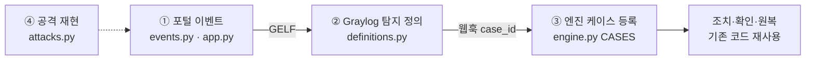

# 구현 실습 매뉴얼 (직접 케이스 만들기)

이 문서는 **직접 손으로 새 보안 케이스를 구현**할 수 있게 쓴 단계별 안내서다. 처음부터 끝까지 순서대로
따라 하면 된다. 각 단계마다 **무엇을 · 어디에 · 왜 · 확인 방법**을 적었다.

> 실습 1(S6)의 모든 단계는 2026-11-12 이 PC에서 그대로 따라 해 확인했다(공격 뒤 52초에 차단·효과 확인,
> 약 99초 뒤 자동 원복). 확인한 뒤 코드는 지워 두었으니, 이제 직접 구현하면 된다.

목차

1. [지금 상태: S1~S12 중 무엇이 됐나](#1-지금-상태-s1s12-중-무엇이-됐나)
2. [처음 한 번: 환경 준비](#2-처음-한-번-환경-준비)
3. [매번: 실행하고 끄기](#3-매번-실행하고-끄기)
4. [기존 케이스로 흐름 익히기(S8)](#4-기존-케이스로-흐름-익히기s8)
5. [케이스는 어떻게 만들어지나(손대는 파일 지도)](#5-케이스는-어떻게-만들어지나손대는-파일-지도)
6. [실습 1: S6 관리자 API 인증 실패 급증 구현](#6-실습-1-s6-관리자-api-인증-실패-급증-구현)
7. [실습 2(도전): S5 차단 후 재시도](#7-실습-2도전-s5-차단-후-재시도)
8. [그다음: S3·S2·S9·S11 설계 힌트](#8-그다음-s3s2s9s11-설계-힌트)
9. [막혔을 때](#9-막혔을-때)
10. [지켜야 할 안전 규칙](#10-지켜야-할-안전-규칙)

---

## 1. 지금 상태: S1~S12 중 무엇이 됐나

케이스 번호와 뜻은 팀 기획서(S1~S12)를 따른다. **구현됨**은 실제 서버로 공격 → 탐지 → 조치 → 원복을 끝까지
확인한 것이다([MEASUREMENTS.md](MEASUREMENTS.md), N=5).

| 케이스 | 내용 | 상태 | 새로 만들 때 필요한 것 | 난이도 |
| --- | --- | --- | --- | --- |
| S1 | 로그인 무차별 대입 | **구현됨**(5/5) | - | - |
| S2 | 심야(22~06시 KST) 로그인 성공 | 미구현 | 포털 신호에 "심야" 판정 추가 + 엔진에 "티켓만" 대응 | 중간 |
| S3 | 한 계정이 짧은 시간에 여러 IP에서 로그인 | 미구현 | 신호는 있음(`login-success`). 출발지가 여러 개라 엔진 쪽 묶기 방식 추가 | 중간~어려움 |
| S4 | 로그인 실패 뒤 성공(계정 탈취) | **구현됨**(5/5) | - | - |
| S5 | 차단된 IP의 계속된 접근 | 미구현 | 신호는 있음(`web.blocked`). 엔진에 "티켓만" 대응 추가 | 중간 → **실습 2** |
| S6 | 관리자 API 인증 실패 급증 | 미구현 | 포털 신호 3줄 + 정의 + 엔진 한 줄(기존 IP 차단 재사용) | **쉬움 → 실습 1** |
| S7 | 홈페이지 변조 | **구현됨**(4/5, 1건은 측정 설계 한계) | - | - |
| S8 | 웹 스캔 뒤 로그인 시도 | **구현됨**(5/5) | - | - |
| S9 | 권한 상승 후 개인정보 조회 | 미구현 | 포털에 권한 승인·민감 조회 이벤트, 대응 API에 "권한 회수" 새로 | 어려움 |
| S10 | 스캔·로그인·경계 신호 연쇄 | **구현됨**(5/5) | - | - |
| S11 | 승인 없는 VPN 원격 접속 | 미구현 | VPN 서버와 작업 승인 데이터가 없다. PC 한 대에서는 시뮬레이터로만 가능 | 어려움 |
| S12 | 요청 폭주(서비스 장애) | **구현됨**(5/5) | - | - |

**결론: 12개 모두 이 저장소 구조로 구현할 수 있다.** 다만 S9·S11은 포털 기능(권한 승인, VPN)이 먼저 있어야 해서
일이 크다. 추천 순서는 **S6 → S5 → S3 → S2 → S9 → S11**이다. 앞 실습에서 만든 것을 뒤 실습이 다시 쓴다.

---

## 2. 처음 한 번: 환경 준비

이미 이 PC에는 준비가 끝나 있다(`.venv`, `.env`, docker 스택). **새 PC나 새 클론**에서만 이 절을 한다.

필요한 프로그램: Python 3.12 이상, Node.js(프론트 빌드), Docker Desktop, Git. PowerShell에서:

```powershell
cd C:\shk\nobugs-soar
.\scripts\setup.ps1 -Live
```

이 한 줄이 가상환경(`.venv`)·의존성·프론트 빌드·`.env`(무작위 비밀값)·docker 스택(Graylog·n8n)·Graylog 탐지 정의를
전부 만든다. 끝에 "설치 상태" 표가 나오는데 전부 OK인지 본다. `-Live`는 탐지가 오면 **실제로 차단**하게 한다(빼면
모의 실행만 한다).

> `.env`에는 비밀값이 들어 있다. 화면에 띄우거나 Git에 올리지 않는다(`.gitignore`로 막혀 있다).

---

## 3. 매번: 실행하고 끄기

### 3-1. 관제 스택이 떠 있는지 확인

```powershell
docker ps --format "{{.Names}} {{.Status}}"
```

`nobugs-soc-graylog-1 ... (healthy)`, `opensearch`, `mongodb`, `n8n`이 보이면 된다. 없으면:

```powershell
docker compose -f infra/docker-compose.yml --env-file .env up -d
```

### 3-2. 서버 4개 띄우기(터미널 4개)

PowerShell 창을 4개 열고 각 창에서 `cd C:\shk\nobugs-soar` 한 뒤 하나씩 실행한다.

```powershell
.\.venv\Scripts\python.exe -m nobugs_tools.run portal    # 민원 포털   http://127.0.0.1:5100
```

```powershell
.\.venv\Scripts\python.exe -m nobugs_tools.run control   # 포털 대응 API http://127.0.0.1:5101
```

```powershell
.\.venv\Scripts\python.exe -m nobugs_tools.run engine    # 대응 엔진   http://127.0.0.1:5200
```

```powershell
.\.venv\Scripts\python.exe -m nobugs_tools.run panel     # 실습 제어판 http://127.0.0.1:5102
```

`nobugs_tools.run`은 `.env`를 읽어 환경변수로 넣은 다음 서버를 띄운다. **꼭 이걸로 띄운다** — uvicorn으로 그냥
띄우면 엔진 키가 비어 Graylog 알림이 전부 401로 막히고, 포털이 이벤트를 Graylog로 보내지 않는다.

잠깐 설정을 바꿔 띄우려면 그 창에서만 환경변수를 먼저 넣는다(터미널 값이 `.env`보다 우선한다).

```powershell
$env:NB_ENGINE_RELEASE_TTL='30'; .\.venv\Scripts\python.exe -m nobugs_tools.run engine   # 원복을 30초로 당김
```

### 3-3. 잘 떴는지 확인

브라우저로 제어판 `http://127.0.0.1:5102`를 연다. 위에 공격 버튼이 보이고 아래 티켓 목록이 5초마다 갱신되면 된다.

### 3-4. 끄기

각 터미널에서 `Ctrl+C`. docker 스택은 켜 둬도 되고, 끄려면:

```powershell
docker compose -f infra/docker-compose.yml --env-file .env stop
```

---

## 4. 기존 케이스로 흐름 익히기(S8)

새 케이스를 만들기 전에, 이미 되는 케이스가 어떻게 흘러가는지 눈으로 본다.

1. 제어판 `:5102`에서 **「S8 웹 스캔→로그인」** 버튼을 누른다(또는 터미널에서
   `.\.venv\Scripts\python.exe -m nobugs_tools.attacks s8 --source 127.47.0.9`).
2. 1분 안쪽(이 PC에서 52초)에 새 티켓이 생기고 단계가 ① 공격 → ② 탐지 → ③ 조치 → ④ 반영 확인 → ⑤ 효과 확인까지 찬다.
3. 90초쯤 뒤 ⑥ 원복이 켜지고 상태가 `restored`가 된다.
4. Graylog `http://127.0.0.1:9100`(로그인은 직접)에서 `rule:web-scan`을 검색하면 포털이 보낸 이벤트가 보인다.

이 흐름을 머릿속에 그려 둔다: **포털이 이벤트를 남기고 → Graylog가 세고 → 기준을 넘으면 엔진을 부르고 → 엔진이 차단·확인·원복한다.**

---

## 5. 케이스는 어떻게 만들어지나(손대는 파일 지도)



새 케이스 하나에 손대는 곳:

| 순서 | 파일 | 무엇을 | 언제 필요한가 |
| --- | --- | --- | --- |
| ① | `src/nobugs_portal/events.py` (`RULES`) · `src/nobugs_portal/app.py` | 포털이 새 신호(이벤트)를 남기게 한다 | 쓸 수 있는 신호가 아직 없을 때 |
| ② | `src/nobugs_tools/definitions.py` | Graylog 탐지 정의 함수 + `ALL_DEFINITIONS` 등록 | 항상 |
| ③ | `src/nobugs_engine/engine.py` (`CASES`) · `src/nobugs_engine/notify.py` (`TITLES`) | 엔진이 이 케이스 번호를 받아 처리하게 한다 | 항상 |
| ③+ | `engine.py`의 `_kinds_needed`·`_handle_locked` | 새로운 **종류의** 대응(티켓만, 권한 회수 등) | 기존 대응(IP 차단·계정 잠금·파일 복구)으로 안 될 때 |
| ④ | `src/nobugs_tools/attacks.py` | 공격 재현 함수 + 명령줄(`s6` 같은) | 항상(검증하려면 공격을 재현해야 한다) |
| ⑤ | `tests/` | 위 모든 것의 시험 | 항상 |
| ⑥ | `docs/BEHAVIOR-SPEC.md` · `README.md` 검증 표 | 동작 명세·결과 기록 | 항상(마지막) |

엔진의 케이스 "종류"(`CaseSpec`의 두 번째 값)는 대응 방식을 정한다. 지금 있는 종류:

| 종류 | 묶는 기준(티켓 하나 = ?) | 대응 | 쓰는 케이스 |
| --- | --- | --- | --- |
| `ip_user` | 계정@출발지 | IP 차단 → TTL 자동 원복 | S1 |
| `account` | 계정@출발지 | 계정 잠금(`zz_` 시험 계정만), 사람이 복구 확인 | S4 |
| `file` | 자산@파일 | 기준본으로 파일 복구·격리 | S7 |
| `scan` | 출발지 | IP 차단(S8→S10 승격, S10은 경계 차단도) | S8, S10 |
| `flood` | 출발지 | 서비스가 실제로 느릴 때만 IP 차단 | S12 |

---

## 6. 실습 1: S6 관리자 API 인증 실패 급증 구현

**목표**: 같은 출발지가 관리자 API(`/api/v1/admin/...`)를 로그인 없이(또는 권한 없이) 두드려 **5분 안에 10번
이상** 401·403을 받으면, 그 출발지 IP를 차단하고 90초 뒤 자동으로 풀기.

**좋은 첫 실습인 이유**: 엔진의 IP 차단·확인·원복 코드를 그대로 다시 쓴다. 새로 쓰는 건 "신호"와 "정의"뿐이다.

### 6-0. 작업 브랜치 만들기

```powershell
cd C:\shk\nobugs-soar
git switch main; git pull
git switch -c feat/s6-admin-auth-fail
```

### 6-1. 포털이 신호를 남기게 하기 ①

**왜**: 지금 포털은 관리자 API 실패를 따로 기록하지 않는다. Graylog가 셀 수 있게 이벤트를 남겨야 한다.

`src/nobugs_portal/events.py`의 `RULES`에 한 줄 추가(이벤트 종류 → 탐지 규칙에서 쓰는 이름):

```python
    "web.file_access": "file-access",
    "admin.auth_failed": "admin-auth-fail",     # ← 추가
}
```

`src/nobugs_portal/app.py`의 미들웨어 `record()` 안, `web.not_found`를 남기는 줄 바로 아래에 추가:

```python
            if response.status_code == 404:
                state.events.emit("web.not_found", outcome="denied", status=404, src_ip=ip, path=path)
            # ↓ 추가: 관리자 API에서 401(로그인 안 함)·403(권한 없음)이 나면 신호를 남긴다
            if path.startswith("/api/v1/admin") and response.status_code in (401, 403):
                state.events.emit("admin.auth_failed", outcome="denied", status=response.status_code,
                                  src_ip=ip, path=path)
```

> 생각해 보기: 왜 미들웨어(모든 요청이 지나가는 곳)에 넣었을까? 관리자 API가 여러 개라도 한 곳에서 다 잡을 수
> 있기 때문이다.

### 6-2. 공격 재현 함수 만들기 ④

**왜**: 신호가 진짜 나오는지 확인하려면 공격을 재현할 수 있어야 한다. (루프백 127.x에서만 동작하게 이미 만들어진
도우미 `bound_opener`·`_call`을 쓴다.)

`src/nobugs_tools/attacks.py`에서 `def boundary_signal(` 바로 위에 함수 추가:

```python
def s6_admin_probe(base_url: str, *, attempts: int = 12, source: str = "127.0.0.2",
                   interval: float = 0.1) -> list[int]:
    """로그인 없이 관리자 API를 반복 호출한다(관리자 API 인증 실패 재현)."""
    _assert_loopback(urllib.parse.urlparse(base_url).hostname or "", "대상")
    opener = bound_opener(source)
    out = []
    for _ in range(attempts):
        out.append(_call(opener, base_url, "GET", "/api/v1/admin/users")[0])
        time.sleep(interval)
    return out
```

같은 파일 `main()`에 명령줄 연결. `s8 = sub.add_parser(...)` 위에:

```python
    s6 = sub.add_parser("s6", help="관리자 API 인증 실패 반복")
    common(s6)
    s6.add_argument("--attempts", type=int, default=12)
```

그리고 아래 `if a.case == ...` 사슬에서 `elif a.case == "s8":` 위에:

```python
    elif a.case == "s6":
        out = s6_admin_probe(a.base, attempts=a.attempts, source=a.source)
        print(f"S6 관리자 API {len(out)}회 호출, 응답: {sorted(set(out))} (출발지 {a.source})")
```

> 주의: 사슬 맨 끝은 `else:`(S12)다. 새 분기는 반드시 `elif`로 그 **위에** 넣는다.

**시험 쓰기** — `tests/test_tools.py` 맨 아래에 추가:

```python
def test_s6_attack_produces_admin_auth_failures(live_portal, settings):
    out = attacks.s6_admin_probe(live_portal, attempts=3, source="127.0.0.6", interval=0)
    assert out == [401, 401, 401]
    fails = [e for e in read_events(settings) if e["event_type"] == "admin.auth_failed" and e["src_ip"] == "127.0.0.6"]
    assert len(fails) == 3 and {e["rule"] for e in fails} == {"admin-auth-fail"}
```

**확인**:

```powershell
.\.venv\Scripts\python.exe -m pytest -q tests/test_tools.py -k s6
```

`1 passed`가 나오면 ①·④가 맞다. (`live_portal`은 시험용 가짜 포털을 실제 소켓으로 띄워 주는 준비물이다.)

### 6-3. Graylog 탐지 정의 만들기 ②

**왜**: "같은 출발지에서 5분에 10번 이상"이라는 판정은 Graylog가 한다. 그 규칙을 코드로 적는다.

`src/nobugs_tools/definitions.py`에서 `def s12_request_flood(` 바로 위에 추가(S12를 본떠 만든다):

```python
def s6_admin_auth_fail(stream_id: str = DEFAULT_STREAM_ID,
                       notification_ids: list[str] | None = None) -> dict[str, Any]:
    """S6: 같은 출발지에서 관리자 API 인증 실패가 5분 안에 10회 이상이면 발동."""
    return _definition(
        "S6 관리자 API 인증 실패 급증 (src_ip)", "같은 출발지에서 관리자 API 인증 실패(401·403)가 5분 안에 10회 이상.",
        "S6", "rule:admin-auth-fail", ["src_ip"], [_COUNT], _count_over(9), 5, MINUTE_MS, 5, stream_id,
        notification_ids)
```

`_definition`에 넘기는 값 순서: 제목, 설명, **케이스 번호**, **검색식**, **묶는 필드**, 세는 방법(`_COUNT`=개수),
**조건**(`_count_over(9)`=9 초과=10 이상), **시간창(분)**, 평가 주기(ms), 재알림 묵음(분), 스트림, 알림.

같은 파일 맨 아래 `ALL_DEFINITIONS`에 등록:

```python
ALL_DEFINITIONS = {..., "S12": s12_request_flood,
                   "S6": s6_admin_auth_fail}
```

**시험** — `tests/test_tools.py`:

1. 이미 있는 `assert set(definitions.ALL_DEFINITIONS) == {...}` 줄에 `"S6"`을 넣는다.
2. 새 시험 추가:

```python
def test_s6_counts_admin_auth_failures_per_source():
    config = definitions.s6_admin_auth_fail()["config"]
    assert config["query"] == "rule:admin-auth-fail" and config["group_by"] == ["src_ip"]
    assert config["conditions"]["expression"]["right"]["value"] == 9          # 10회 이상
    assert config["search_within_ms"] == 5 * 60_000
```

### 6-4. 엔진에 케이스 등록하기 ③

**왜**: Graylog가 `case_id: "S6"`으로 엔진을 불러도, 엔진이 S6을 모르면 `unsupported_case`로 무시한다.

`src/nobugs_engine/engine.py`의 `CASES`에 한 줄:

```python
    "S12": CaseSpec("요청 폭주", "flood"),
    "S6": CaseSpec("관리자 API 인증 실패 급증", "ip_user"),   # ← 추가: IP 차단·자동 원복 재사용
}
```

`src/nobugs_engine/notify.py`의 `TITLES`에도 같은 제목(알림 문구에 쓰인다):

```python
          "S8": "웹 스캔 뒤 로그인 시도", "S10": "스캔·로그인·경계 차단 신호 연쇄", "S12": "요청 폭주",
          "S6": "관리자 API 인증 실패 급증"}
```

> 왜 `ip_user`인가? 5절 표처럼 `ip_user`는 IP 차단 + TTL 자동 원복이다. 로그인 없이 두드린 경우 계정은 비어
> 있어 묶음 키가 `-@출발지`가 된다. `scan`을 고르면 S8·S10 티켓과 섞이고, `flood`를 고르면 서비스가 느릴 때만
> 막으니 S6에는 맞지 않는다.

**시험** — `tests/test_engine_m5.py` 맨 아래:

```python
def test_s6_blocks_the_source_ip(rig):
    r = det(rig, "S6")
    assert r["verdict"] == "responded" and ATTACKER in rig.portal.blocked
    assert tk(rig, r["ticket_id"])[0].case_id == "S6"
```

### 6-5. 전체 시험·린트

```powershell
.\scripts\test.ps1
```

(또는 `.\.venv\Scripts\python.exe -m pytest -q` 와 `.\.venv\Scripts\python.exe -m ruff check src tests`)
전부 통과해야 다음으로 간다. 실패하면 9절을 본다.

### 6-6. 실제 서버로 한 사이클 확인

1. 3절대로 서버 4개를 띄운다(**포털·엔진은 코드를 바꿨으니 반드시 껐다 다시 띄운다**).
2. Graylog에 새 정의를 올린다(S1은 n8n 경유를 유지하려고 `--n8n-url`도 준다):

   ```powershell
   .\.venv\Scripts\python.exe -m nobugs_tools.graylog setup --engine-url http://host.docker.internal:5200/webhook/graylog --n8n-url http://n8n:5678/webhook/s1 --live
   ```

   출력에 `탐지 정의 S6: 생성`이 나오면 된다.
3. 공격:

   ```powershell
   .\.venv\Scripts\python.exe -m nobugs_tools.attacks s6 --source 127.46.0.1
   ```

   `응답: [401]`이 나와야 한다.
4. 제어판 `:5102` 또는 엔진 `http://127.0.0.1:5200`에서 **S6 티켓**이 생기는지 본다(1분 안쪽, 확인할 때 52초).
   단계 ⑤ 효과 확인까지 초록이면 성공.
5. 90초쯤 뒤 `restored`가 되면 자동 원복까지 완료(확인할 때 약 99초).

확인한 시각·걸린 시간을 적어 둔다. 6-7에서 쓴다.

### 6-7. 기록하고 올리기 ⑥

1. `docs/BEHAVIOR-SPEC.md` 3절 표에 S6 행 추가(조건 · 묶기 · 대응 · 원복).
2. `README.md` "검증 표"에 S6 행 추가 — **직접 확인한 만큼만** 쓴다(한 번 돌렸으면 "1회 확인", N=5를 재면 숫자).
3. (선택) N=5 측정: `src/nobugs_tools/measure.py`에 `_s6_round`를 `_s8_round`를 본떠 만들고 표에 등록한 뒤
   `python -m nobugs_tools.measure --case S6 --rounds 5`.
4. 커밋·PR:

   ```powershell
   git add -A
   git commit -m "feat(s6): 관리자 API 인증 실패 급증 탐지·IP 차단"
   git push -u origin feat/s6-admin-auth-fail
   gh pr create --repo shk12170-dev/nobugs-soar --fill
   ```

**실습 1 체크리스트**

- [ ] 포털이 `admin.auth_failed`(rule `admin-auth-fail`) 이벤트를 남긴다
- [ ] `attacks s6`가 401을 받는다
- [ ] `ALL_DEFINITIONS`에 S6, Graylog에 S6 정의가 생성됐다
- [ ] 엔진 `CASES`·`TITLES`에 S6
- [ ] 시험 전부 통과, 린트 통과
- [ ] 실서버에서 티켓 ⑤ 효과 확인 → `restored`
- [ ] BEHAVIOR-SPEC·README에 확인한 만큼만 기록

---

## 7. 실습 2(도전): S5 차단 후 재시도

**목표**: 이미 차단된 IP가 10분 안에 20번 이상 계속 접근하면 **티켓만** 연다(조치는 하지 않고 사람에게 알린다).

이번에는 코드를 다 주지 않는다. 실습 1을 떠올리며 스스로 채운다.

**이미 있는 것**: 포털은 차단된 IP가 오면 `web.blocked` 이벤트를 남긴다(`src/nobugs_portal/app.py` 미들웨어 맨 앞).
`RULES`에 없어서 rule 값도 `web.blocked` 그대로다.

**만들 것**

1. ① `RULES`에 `"web.blocked": "blocked-retry"`를 넣어 이름을 정리한다. (기존 시험이 깨지지 않는지 본다.)
2. ② 정의 `s5_blocked_retry`: 검색 `rule:blocked-retry`, 묶기 `src_ip`, `_count_over(19)`, 시간창 10분.
3. ③ **엔진에 새 종류 `notify`(티켓만)** — 이 실습의 핵심이다.
   - `CASES["S5"] = CaseSpec("차단 후 재시도", "notify")`
   - 지금 `_handle_locked`는 `_kinds_needed`가 돌려준 조치를 하나도 못 찾으면 "이미 다 했다(`duplicate`)"로
     끝난다. 조치가 없는 케이스라 이대로는 늘 `duplicate`가 된다. `spec.kind == "notify"`이면 티켓을 열고
     (`_ticket_for`), 처음 연 경우에만 알림(`self.notifier.send(format_message("warn", ...))`)을 보내고
     `{"verdict": "ticket_only", ...}`를 돌려주는 분기를 `with self.store.session()` 안에 만든다.
   - 조치가 없으니 원복도 없다. 티켓은 사람이 닫는다 — 그런데 `close`는 `restored` 상태에서만 된다
     (`store.py`의 상태 전이표). `notify` 티켓을 어느 상태에 둘지 정하고, 그에 맞게 닫을 수 있게 할지 고민한다.
4. ④ 공격 재현 `s5_blocked_retry`: 먼저 같은 출발지로 S8을 쏴 차단되게 한 뒤(또는 시험에서는 대응 API로 직접
   차단), 20번 넘게 GET을 보낸다. **원복 TTL(90초) 안에** 끝나야 한다.
5. ⑤ 시험: 엔진 시험에서 "S5는 조치 없이 티켓만 열고, 같은 출발지 두 번째 탐지에는 알림을 또 보내지 않는다".

**생각할 거리**: 차단된 IP의 요청은 `web.request`를 남기기 전에 끊긴다. 그래서 S5 공격이 S12(요청 폭주)를
같이 일으키지는 않는다. 왜 그런지 `app.py`에서 찾아본다.

---

## 8. 그다음: S3·S2·S9·S11 설계 힌트

| 케이스 | 신호 | 어려운 점 | 힌트 |
| --- | --- | --- | --- |
| S3 다중 출발지 | `login-success`(이미 있음) | Graylog가 `username`으로 묶으면 출발지가 여러 개라 웹훅에 `src_ip`가 하나로 안 온다. 지금 엔진은 `src_ip`가 꼭 있어야 한다 | 정의는 `require_src_ip=False`(S7이 쓰는 방식). 엔진에는 `file`처럼 IP 없이 처리하는 분기 + 실습 2의 `notify` 재사용. 묶기 키는 계정 |
| S2 심야 로그인 | 새로 필요 | 심야 판단 시각(KST)과 시험 방법. 낮에 시험하려면 시간대를 설정으로 바꿀 수 있어야 한다 | 포털 `auth.login_succeeded`에 `night: true/false` 필드를 넣고(심야 시간대는 `Settings`에서 읽기), 정의 검색은 `rule:login-success AND night:true`. 대응은 `notify` |
| S9 권한 상승 + 개인정보 조회 | 새로 필요 2개 | 포털에 "승인된 권한 변경"이라는 개념이 없다. 대응 "권한 회수"는 대응 API(5101)·엔진 조치를 새로 만들어야 한다 | ① 관리자 권한 변경 API에 승인 여부 기록 ② 민감 조회 이벤트 ③ 대응 API `POST /roles/revoke` + 엔진 `_attempt_*` 하나 + 확인(재조회) + 원복 |
| S11 무승인 VPN | 새로 필요 | 실제 VPN(pfSense OpenVPN)과 작업 승인표가 없다 | 경계 시뮬레이터(`nobugs_boundary`)처럼 **VPN 시뮬레이터**를 만들어 `vpn-login`(approved 여부) 신호를 보내게 하고, 대응은 "세션 회수 + 계정 비활성". 실제 VPN 연동은 범위 밖으로 문서에 밝힌다 |

새 종류의 대응을 만들 때는 [BEHAVIOR-SPEC.md](BEHAVIOR-SPEC.md) 4절 안전 규칙(기본 모의 실행, 보호 대상, 멱등,
같은 대상 열린 티켓 하나, TTL 원복)을 그대로 지킨다.

---

## 9. 막혔을 때

| 증상 | 먼저 볼 것 |
| --- | --- |
| 공격을 쐈는데 티켓이 안 생김 | ① 포털을 `nobugs_tools.run portal`로 띄웠나(GELF 켜짐) ② Graylog에서 `rule:<이름>` 검색이 되나 ③ `graylog setup` 출력에 그 케이스 정의가 있나 ④ 최대 1분(평가 주기) 기다렸나 |
| Graylog엔 이벤트가 있는데 엔진 티켓이 없음 | 엔진을 `nobugs_tools.run engine`으로 띄웠나(키), 엔진 `CASES`에 번호가 있나(없으면 `unsupported_case`), `notify.py`가 아니라 `engine.py`에 넣었나 |
| 티켓이 `dry_run`으로만 끝남 | `graylog setup`에 `--live`를 줬나 |
| 공격이 429 | 같은 출발지로 로그인을 너무 많이 함(5분에 20회 제한). `--source`를 바꾼다 |
| 티켓이 `verified`에서 안 넘어감 | 아직 원복 TTL(90초) 전. 기다리거나 `NB_ENGINE_RELEASE_TTL`을 낮춰 엔진 재시작 |
| 코드를 바꿨는데 반영 안 됨 | 서버는 자동 재시작하지 않는다. 그 서버 창에서 `Ctrl+C` 후 다시 실행 |
| 시험 하나만 돌리고 싶다 | `pytest -q tests/파일.py -k 이름일부` |
| `UnicodeEncodeError: 'cp949'` | 출력 문자열에 `—`(긴 줄표) 같은 문자가 있다. 한국어 Windows 콘솔이 못 찍는다 → `-`로 바꾼다 |

---

## 10. 지켜야 할 안전 규칙

- 공격 재현은 **루프백(127.x)에서만** 한다. 도우미가 다른 주소를 거부한다(`_assert_loopback`). 이 검사를 끄지 않는다.
- 비밀값은 `.env`에만 둔다. 출력·로그·커밋·이슈에 붙여 넣지 않는다.
- 엔진의 기본은 **모의 실행**이다. 실제 조치는 `--live`로 연결한 알림에서만 일어난다.
- S4처럼 계정을 잠그는 대응은 `zz_` 시험 계정에만 한다. 새 대응도 이런 "실제로 건드려도 되는 대상" 제한을 둔다.
- 결과는 **확인한 만큼만** 적는다(확인·부분·미확인). 확인 못 한 것을 성공으로 쓰지 않는다.
- 팀 저장소 코드는 복사하지 않는다([CLEANROOM.md](CLEANROOM.md)). 팀 문서의 케이스 정의(명세)만 참고한다.
